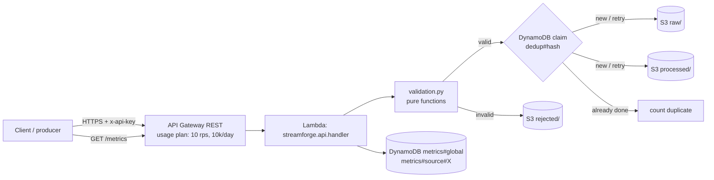

# Architecture (Phase 1)



## Layering
| Layer | Module | AWS-aware? |
|---|---|---|
| HTTP mapping, routing, size limits | `api.py` | no (only `get_service()` wires AWS) |
| Orchestration (validate → dedupe → store → metrics) | `service.py` | no |
| Validation / transforms / key layout | `validation.py`, `transform.py` | no |
| Storage interfaces + in-memory/file impls | `stores.py` | no |
| S3 + DynamoDB adapters | `aws_stores.py` | yes |
| Infrastructure | `infrastructure/` (CDK, Python) | yes |

Because the service takes injected stores, the same code runs on AWS, in unit tests, and under `scripts/local_server.py`.

## S3 layout
```
raw/year=YYYY/month=MM/day=DD/source=<source>/<sha256(source,event_id)[:32]>.json
processed/year=YYYY/month=MM/day=DD/source=<source>/<same hash>.json
rejected/year=YYYY/month=MM/day=DD/<request_id>-<index>.json
```
`raw` and `processed` are partitioned by **event** date (UTC) so keys are deterministic on retry. `rejected` is partitioned by **arrival** date. Hive-style partitions make later Athena/Glue use straightforward. Format is JSON, one object per event; Parquet/compaction is a planned later step (small objects are inefficient for analytics).

## Rejection / dead-letter strategy
Invalid events are never dropped silently: each produces a `rejected/` object holding the validation errors and **safe diagnostics** (SHA-256 of the event, size, top-level key names, `event_id`/`event_type`/`source` if they are strings). Payload values are not stored or logged. The client also receives the errors in the HTTP response. (Rejected objects expire after 90 days.) Processing *failures* (storage outages) are different: they are returned as retryable 503s.

## Idempotency guarantees and limits
- Identity = `(source, event_id)`. A DynamoDB conditional put claims the identity as `pending`; after both S3 writes succeed it is marked `done`.
- A replay of a `done` event → HTTP 200 `duplicate`, nothing rewritten.
- If a crash/outage happens after the claim but before `done`, the next attempt sees `pending` and **reprocesses** (S3 keys are deterministic, so rewriting is idempotent). No event is lost to a half-finished attempt.
- **Not exactly-once.** It is at-least-once delivery with effectively-once storage under normal conditions. Limits:
  - Two truly *concurrent* requests with the same new id: one wins `NEW`, the other sees `RETRY` and also writes; the output is the same object, but both may be counted as `valid`, slightly inflating `valid`.
  - The dedup window is 30 days (DynamoDB TTL, which is best-effort deletion); an id replayed after that is accepted again.
  - Same `event_id` with *different* content is treated as a duplicate; the first write wins.
  - Metrics updates are a separate write after storage; if the Lambda dies between them counts can undercount.

## Metrics
Atomic DynamoDB `ADD` counters, so they reflect actual traffic. `received = valid + invalid + duplicate + processing_failures` (mutually exclusive). `GET /metrics` also reports `valid_rate`, average batch processing time (ms), `last_success_at` and per-source counts. `Scan` is used to list sources, which is fine for a small table but would be replaced by an index or a Phase 2 warehouse query at scale.

## Security
API key + usage plan (throttle 10 rps / burst 20, 10 000 requests/day), 256 KB body cap, ≤100 events per batch, S3 block-public-access + TLS-only + SSE-S3, Lambda role limited to `s3:PutObject` on three prefixes and four DynamoDB actions on one table, source names restricted to `[A-Za-z0-9._-]` so they cannot shape S3 keys, 5xx responses never include internals. `/health` is the only unauthenticated route and returns a static body. The API key is a coarse shared secret, not per-user auth; production would use IAM/Cognito/JWT authorizers.
